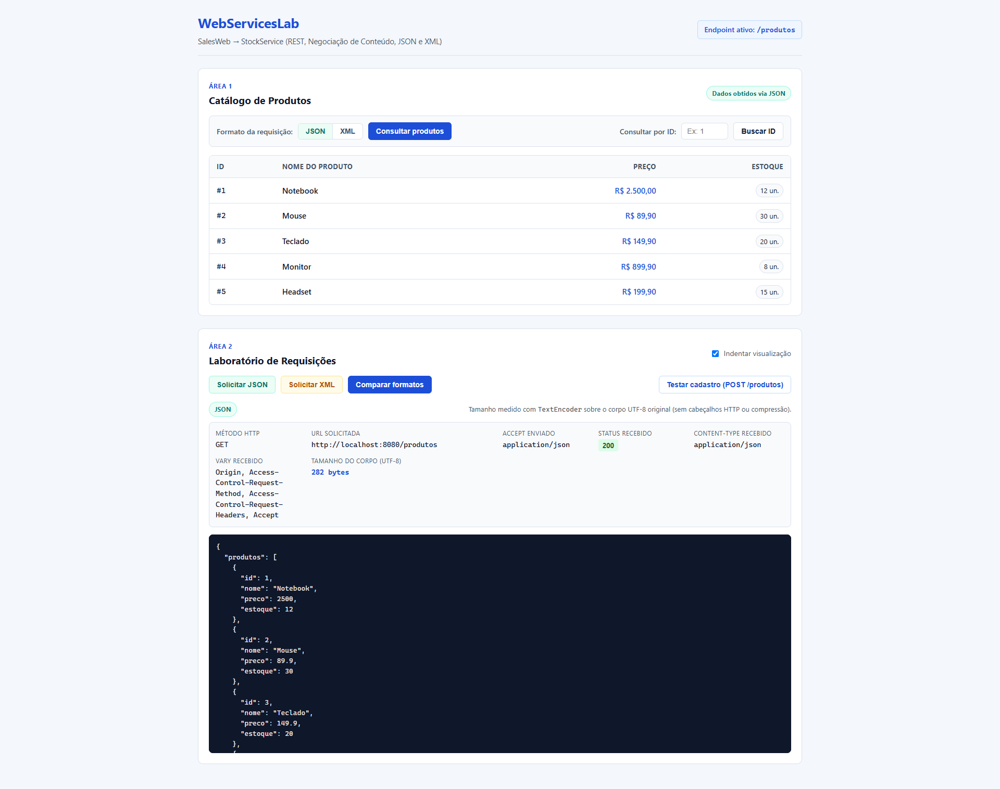
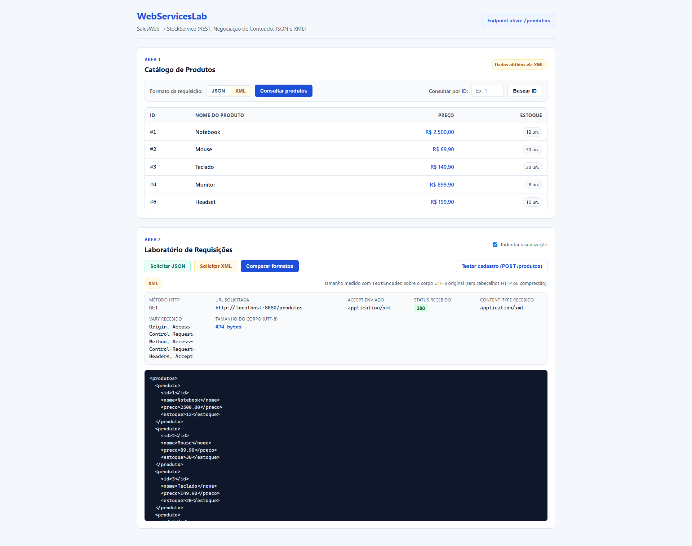
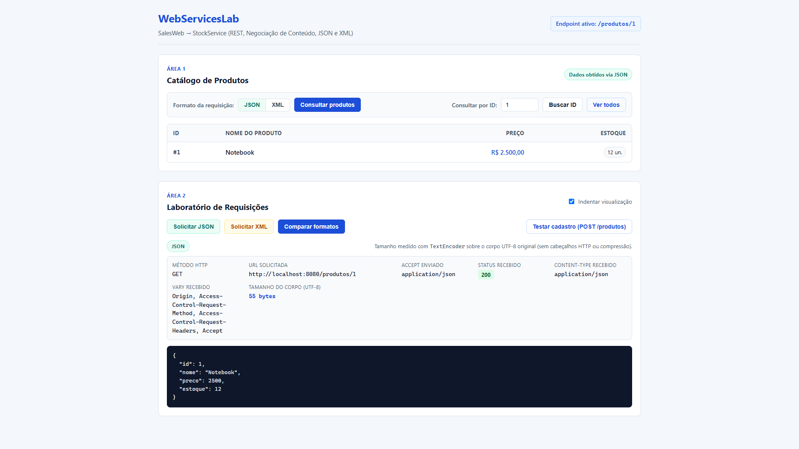
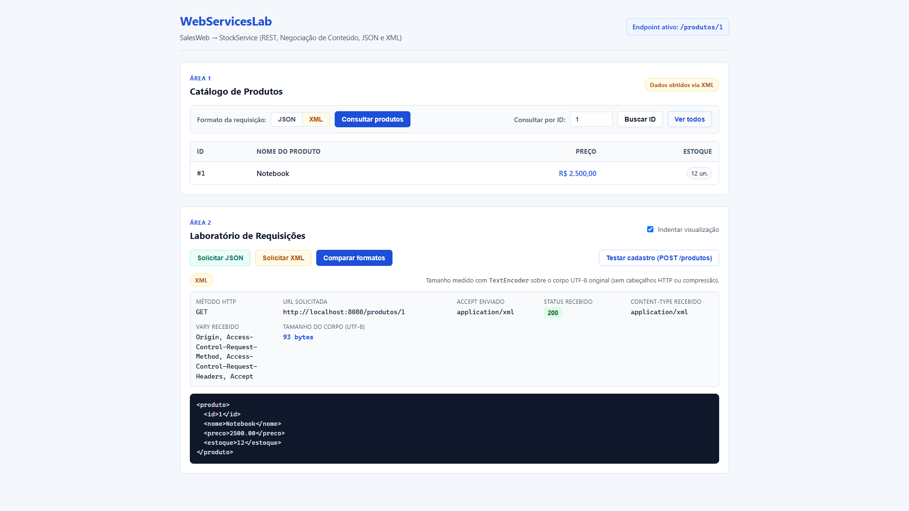
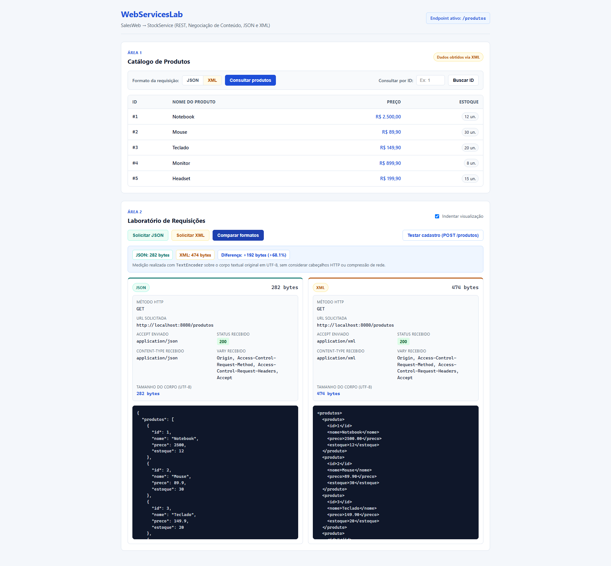
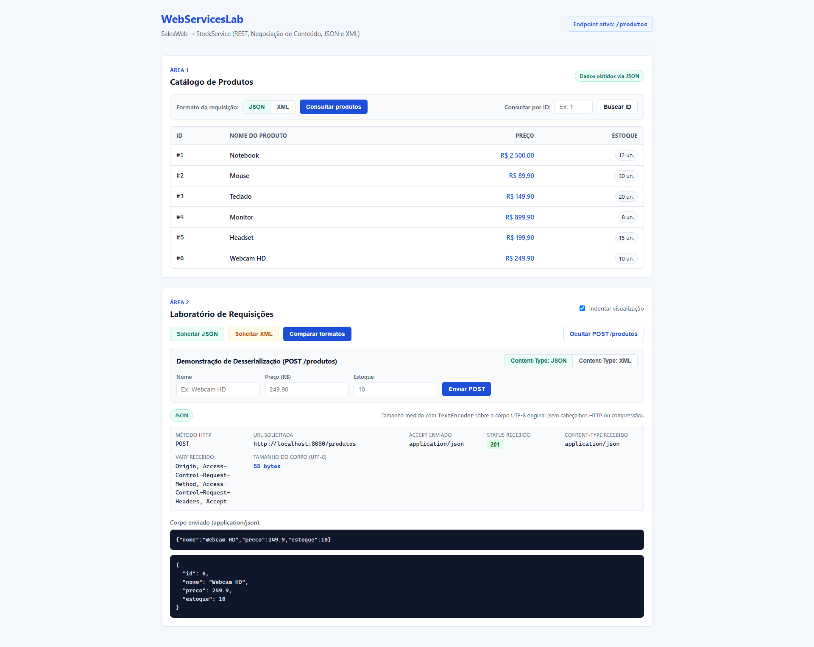
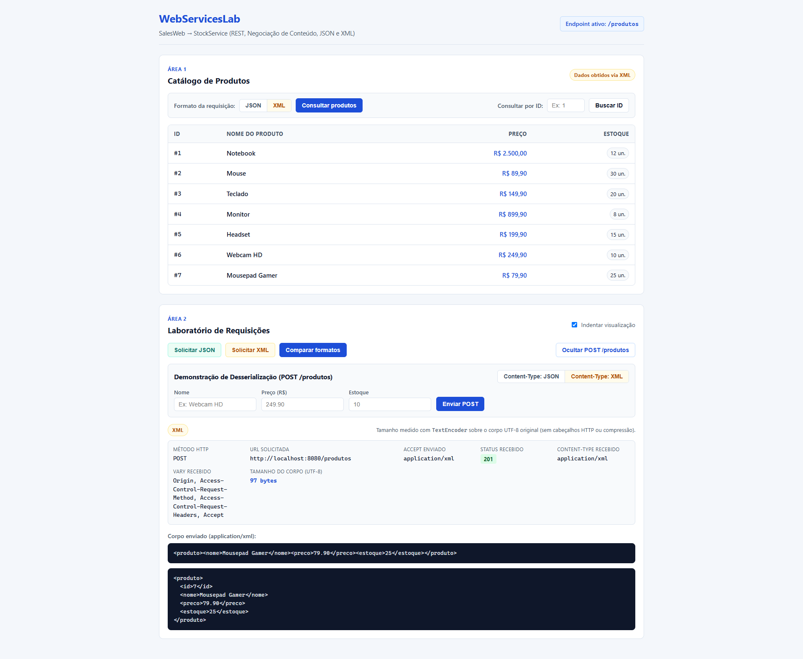
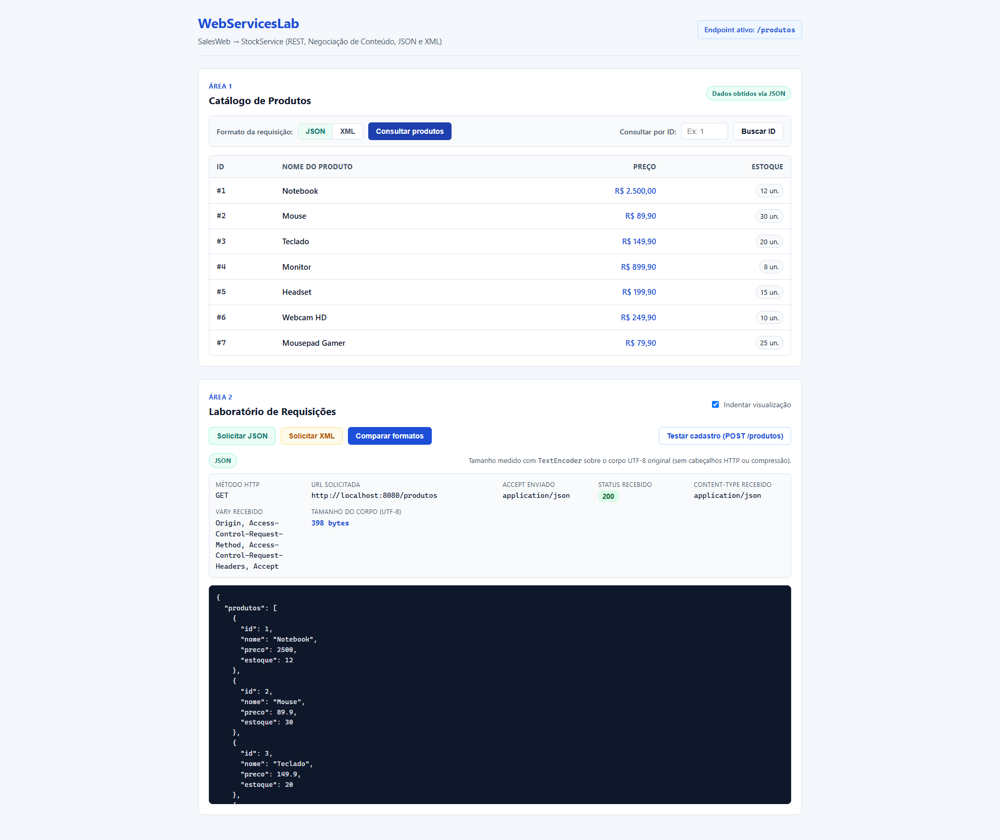
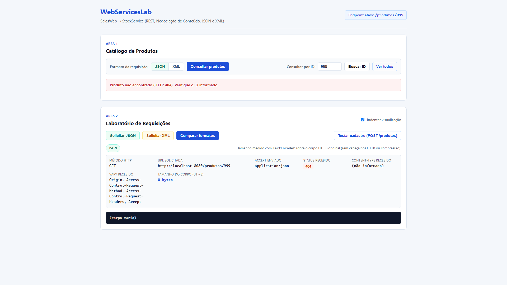

# SalesWeb — WebServicesLab

Aplicação cliente em **React + Vite** do projeto acadêmico **WebServicesLab** (SENAI), desenvolvida para consumir o Web Service **StockService** via HTTP REST e demonstrar na prática a **negociação de conteúdo** entre **JSON** e **XML**.

- **Repositório do Back-end (`StockService`)**: https://github.com/RHU4N/StockServiceXmlJson

## Tecnologias Utilizadas

- **React** (`19.3.1`)
- **Vite** (`8.3.8`)
- **JavaScript** (sem TypeScript)
- **Axios** (`1.21.1`) configurado com `responseType: 'text'` para preservar o corpo bruto da resposta
- **CSS puro** (sem frameworks ou bibliotecas de componentes)
- **DOMParser** nativo do navegador para interpretação de XML
- **TextEncoder** nativo para medição real do corpo da resposta em bytes UTF-8

## Funcionalidades

- **Área 1 — Catálogo de Produtos**: consulta todos os produtos (`GET /produtos`) ou um produto específico por ID (`GET /produtos/{id}`) solicitando `application/json` ou `application/xml`, exibindo dados equivalentes com preços formatados em reais (`R$`).
- **Área 2 — Laboratório de Requisições**: exibe método HTTP, URL solicitada, cabeçalho `Accept` enviado, status HTTP, `Content-Type`, `Vary`, tamanho real em bytes UTF-8 e corpo original retornado pelo servidor. Inclui o modo **Comparar formatos** (requisições paralelas em JSON e XML lado a lado) e teste de desserialização via `POST /produtos`.

## Como Executar Localmente

Certifique-se de que o back-end **StockService** esteja em execução em `http://localhost:8080`.

```bash
npm install
npm run dev
```

A aplicação ficará disponível em `http://localhost:5173`.

### Outros comandos úteis

```bash
npm run lint
npm run build
```

> **Nota sobre a medição em bytes**: o cálculo com `TextEncoder` considera apenas o corpo textual original em UTF-8 recebido do servidor, sem incluir cabeçalhos HTTP ou compressão de rede.

---

## Evidências de Funcionamento

Todas as capturas reais em alta resolução (`1920 × 1080`) estão separadas na pasta [`evidencias/`](evidencias/) para facilitar o download e uso na apresentação.

### Visão Geral da Interface


### Catálogo em JSON (`282 bytes`) vs XML (`474 bytes`)



### Consulta Individual (`/produtos/1`) em JSON (`55 bytes`) e XML (`93 bytes`)



### Comparação Lado a Lado (JSON vs XML)


### Desserialização via `POST /produtos` (JSON e XML) e Catálogo Atualizado




### Tratamento de Erro — Produto Não Encontrado (`HTTP 404`)

